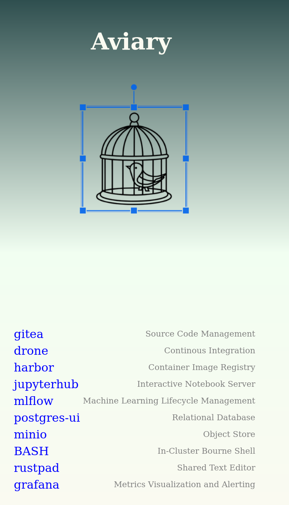

aviary-deploy
=============

IaC to stand up a basic dev environment on a Kubernetes cluster backed by an NFS server. wip.

The Aviary Platform gives engineering teams access to a suite of tools running in a Kubernetes cluster. Included are tools to store data, build software, and develop machine learning models. The tools are exposed through a shared Envoy Gateway (Kubernetes Gateway API) with internal CA-signed certs.

Layout
======

Terraform/OpenTofu configuration is grouped by role:

- `apps/` — user-facing applications
  - `argo` — Argo CD (`argo.<base_domain>`)
  - `aviary-frontend` — platform landing page (`aviary.<base_domain>`)
  - `bash` — CloudTTY in-browser shell (`bash.<base_domain>`)
  - `drone` — Drone CI (`drone.<base_domain>`)
  - `rustpad` — collaborative text editor (`rustpad.<base_domain>`)
- `system/` — cluster services
  - `envoy-gateway` — Gateway API ingress; the shared `aviary` Gateway that fronts every app
  - `headlamp` — cluster UI (`headlamp.<base_domain>`)
  - `grafana` — dashboards (`grafana.<base_domain>`)
  - `harbor` — container registry (`harbor.<base_domain>`)
  - `velero` — backup/restore (`velero.<base_domain>`)
- `data/` — stateful services
  - `gitea` — self-hosted git (`gitea.<base_domain>`, ssh via `ssh.gitea.local`)
  - `postgres` — Percona and Zalando Postgres operators, plus the Zalando UI (`postgres-ui.<base_domain>`)
- `disabled/` — modules that are not currently applied (`jitsi`, `jupyterhub`, `minio`, `mlflow`, `qdrant`). Each is self-contained (its own variables, and for minio its provider); move a file up into `apps/`, `system/`, or `data/` and add its host to `local.vhosts` to enable it.

Root files hold shared config: `variables.tf`, `terraform.tfvars` (your copy of `terraform.tfvars.example`), `providers.tf`, `versions.tf`, the `Makefile`, and `stack.mk` (the per-stack Makefile, symlinked into each stack).

Requires the `helm`, `kubernetes` and `gavinbunney/kubectl` providers (see `versions.tf`).

The cluster is expected to bring its own CNI, LoadBalancer pool, cert-manager (with a ClusterIssuer, `cluster_issuer`) and a default StorageClass (`global_storage_class`); this repo no longer installs Cilium, MetalLB, ingress-nginx, cert-manager or the NFS CSI driver.

Ingress uses the **Kubernetes Gateway API**. `system/envoy-gateway.tf` installs Envoy Gateway, defines a single shared `aviary` Gateway, and generates one HTTPS listener + one `HTTPRoute` per app from the `local.vhosts` table. TLS terminates at the Gateway: each listener references an `<app>-tls` secret provisioned by cert-manager, so **cert-manager must run with Gateway API support enabled** (`config.enableGatewayAPI=true`, i.e. `--feature-gates=ExperimentalGatewayAPISupport=true`). To expose a new app, add an entry to `local.vhosts` rather than writing an `Ingress`.

Quickstart
==========

Prerequisites:

- [OpenTofu](https://opentofu.org/) (`tofu`) or Terraform installed
- A reachable Kubernetes cluster and a kubeconfig for it
- `kubectl` and `helm` on your PATH (handy for troubleshooting)

Apply the configuration:

```sh
# 1. Clone and enter the repo
git clone <repo-url> aviary-deploy
cd aviary-deploy

# 2. Configure your deployment.
#    At minimum set `kubeconfig`, `ssh_load_balancer_ip` and the passwords.
cp terraform.tfvars.example terraform.tfvars
$EDITOR terraform.tfvars

# 3. Download providers and initialize every stack
make init

# 4. Preview the changes (optional but recommended)
make plan

# 5. Apply (data -> apps -> system)
make apply
```

Argo CD's initial admin password is generated by its chart:

```sh
kubectl -n argo get secret argocd-initial-admin-secret -o jsonpath='{.data.password}' | base64 -d
```

Gitea/Drone is a two-phase install: apply once, create the OAuth2 application
for Drone in Gitea (redirect URI `https://drone.<base_domain>/login`), put its id and
secret in `terraform.tfvars` (`drone_gitea_client_id/_secret`) and `make apps`
again.

Finally, point the ingress hostnames at your cluster by adding entries to
`/etc/hosts` (see the `Installing` section below for a sample).

To tear the environment down: `tofu destroy` (read the Notes below first).

Installing
==========

1. `git clone` this repo and `cd aviary-deploy`
2. `cp terraform.tfvars.example terraform.tfvars` and point `kubeconfig` at your cluster
3. Edit `terraform.tfvars` to taste (passwords, the Gitea ssh LB IP, storage class)
4. `make init`
5. `make plan` then `make apply` (or `make apply-auto` to plan and apply in one shot)
6. Set up a Gitea OAuth2 app for Drone, put the client id/secret in `terraform.tfvars`, and `make apps`
7. Add the ingress hostnames to your `/etc/hosts` (see below)

The root `Makefile` runs each target in every stack, in apply order
(`data`, `apps`, `system`; `destroy` goes the other way):

```
make init          # tofu init in each stack
make validate      # tofu validate in each stack
make fmt           # tofu fmt
make plan          # plan each stack to <stack>/tfplan using terraform.tfvars
make apply         # apply the saved plans
make apply-auto    # plan + apply with -auto-approve
make destroy       # tofu destroy, system -> apps -> data
make refresh       # tofu refresh
make output        # tofu output
```

Sub-stacks
==========

Each role folder (`apps/`, `system/`, `data/`) is an independent OpenTofu stack
with its own state. The shared root files (`providers.tf`, `versions.tf`,
`variables.tf`, `terraform.tfvars`) and the stack `Makefile` (`stack.mk`) are
symlinked into each folder.

Drive one stack from the root Makefile (defaults to `apply-auto`; pick another
`stack.mk` target with `CMD=`):

```
make data                 # apply the data/ stack
make apps CMD=plan        # plan the apps/ stack
make system CMD=destroy   # destroy the system/ stack
```

Or run `make` directly inside a folder (e.g. `cd system && make plan`, or
`make target T=helm_release.grafana` to plan one resource).

Apply order matters: **`data` -> `apps` -> `system`**. The `system` stack's
`HTTPRoute`s are created in the app namespaces, and the gitea/drone
`ExternalName` aliases point at the shared gateway, so the backing apps and the
gateway should exist first. Because the stacks have separate state, this
ordering is not enforced by OpenTofu -- it is up to you.

/etc/hosts
==========

Point the web hostnames at the Envoy Gateway LoadBalancer IP (`kubectl -n envoy-gateway get gateway aviary`), and `ssh.gitea.<base_domain>` at the Gitea SSH LoadBalancer IP (`ssh_load_balancer_ip` in `terraform.tfvars`). Both come from your cluster's LoadBalancer pool (MetalLB or Cilium LB IPAM).

```
<gateway-lb-ip>   aviary.local argo.aviary.local bash.aviary.local drone.aviary.local grafana.aviary.local harbor.aviary.local headlamp.aviary.local rustpad.aviary.local velero.aviary.local postgres-ui.aviary.local gitea.aviary.local
<gitea-ssh-lb-ip> ssh.gitea.aviary.local
```

Notes
=====

Take care to preserve your PVCs when re-deploying.

`tofu destroy` skips helm installs that are in progress. Take a look at `helm ls -A` and also check for `sa`, `secret`, and `cm` resources in the associated namespaces before reapplying.

Current runs against an Ubuntu / kubeadm cluster running under KVM with MetalLB seem good.


